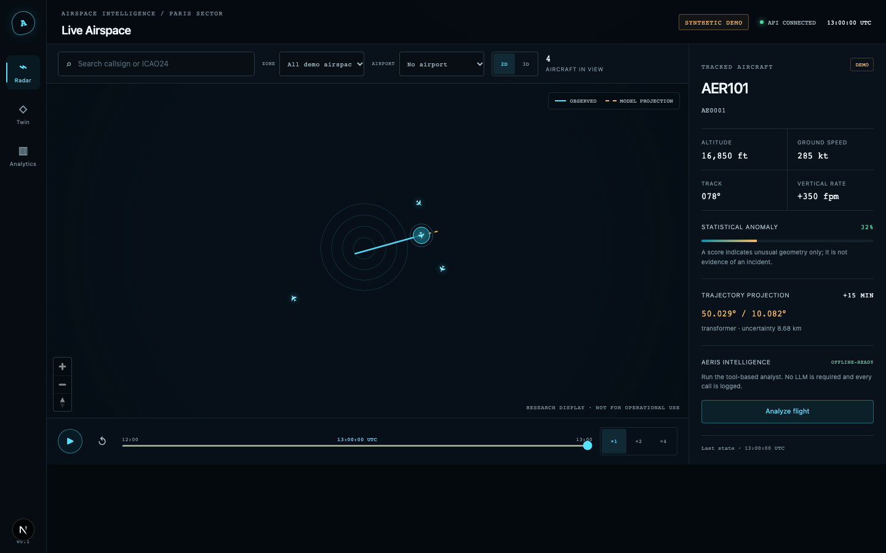

# AERIS AI

AI-powered airspace intelligence, built as an honest and reproducible research
platform. The current release provides a complete offline radar, Digital Twin
and analytics journey backed by synthetic data, trained prediction/anomaly
models and tool-driven intelligence specialists.



Digital Twin and analytics screenshots are available in [`docs/qa`](docs/qa/).

> Experimental software only. It is not certified for navigation, air-traffic
> control, separation, or any safety-critical use.

## What works today

- Interactive MapLibre radar with four reproducible synthetic flights, sector
  filters, static airport focus and 2D/3D perspective controls
- UTC flight replay with play/pause, speed and timeline controls
- Observed tracks and trained 5/10/15-minute Transformer predictions, with a
  constant-vector fallback for short histories or unavailable artifacts
- Explainable anomaly evidence, scenario simulation and intelligence reports
- Digital Twin workspace with injected anomalies, synthetic wind, before/after
  anomaly scores and comparative Transformer forecasts
- Analytics workspace backed by live API summary and normalized flight telemetry
- Trained 15/30/60-minute Random Forest density forecast that improves synthetic
  held-out mean MAE from 2.63 to 1.88 aircraft versus persistence
- A checksum-verified Isolation Forest trained/evaluated on labelled synthetic
  scenarios, with an automatic transparent-rule fallback
- LSTM/GRU/Transformer training with early stopping and flight-disjoint temporal
  splits; the selected Transformer improves synthetic held-out mean MAE from
  6.35 km (constant-vector baseline) to 3.45 km
- Four tool-driven intelligence specialists with optional local Ollama narration
- Optional OpenSky live vectors and Aviation Weather Center METAR connectors,
  both rate-aware and disabled from the reproducible offline path
- Responsive desktop/tablet/mobile interface with keyboard and screen-reader
  support
- Typed FastAPI contracts, strict TypeScript, 90%+ backend coverage, E2E and
  accessibility tests
- Docker Compose stack with Next.js, FastAPI and PostgreSQL/PostGIS

The project never labels a heuristic as ML or deterministic text as an LLM
answer. Learned models must beat documented baselines before promotion.

## Quick start

Requirements: Python 3.11+, Node.js 22+ and npm.

```bash
python3.11 -m venv .venv
source .venv/bin/activate
python -m pip install -e '.[dev,database,ml,dl]'
npm --prefix frontend ci
pre-commit install
```

Start the API and web application in separate terminals:

```bash
source .venv/bin/activate
uvicorn backend.app.main:app --reload
```

```bash
npm --prefix frontend run dev
```

Open <http://localhost:3000>. API documentation is available at
<http://localhost:8000/docs>. No account, API key, database or network feed is
needed for the demo.

For the containerized stack:

```bash
docker compose up --build
```

The PostGIS tag currently uses amd64 emulation on Apple Silicon. The offline
demo does not persist into PostGIS yet; the database is provisioned for the next
repository/ingestion increment.

## Quality checks

```bash
ruff check backend
mypy backend
pytest --cov=backend --cov-report=term-missing --cov-fail-under=90
npm --prefix frontend run lint
npm --prefix frontend run typecheck
npm --prefix frontend test
npm --prefix frontend run build
npm --prefix frontend run test:e2e
pre-commit run --all-files
```

The E2E suite starts both services, tests the radar, Digital Twin and analytics
journeys plus loading/empty/error states, runs Axe serious/critical
accessibility checks, and captures rendered evidence in `docs/qa/`.

## Repository map

```text
backend/        FastAPI routes, provider protocol and domain services
frontend/       Next.js radar, Digital Twin, analytics and browser tests
docker/         Non-root production image definitions
docs/           Architecture, data policy, design contract, QA and roadmap
compose.yaml    Local API/web/PostGIS stack
pyproject.toml  Python package, tool configuration and dependency ranges
```

Read [the architecture](docs/architecture.md), [data-source policy](docs/data-sources.md),
[anomaly model card](docs/ml-anomaly.md), [trajectory model card](docs/dl-trajectory.md),
[density model card](docs/ml-density.md),
[AERIS Intelligence](docs/intelligence.md), [design contract](docs/design-contract.md),
and [delivery roadmap](docs/roadmap.md).

## Configuration

Copy `.env.example` to `.env` only when overriding defaults. Provider, database
and optional LLM credentials are server-side variables. Never place secrets in
`NEXT_PUBLIC_*` variables or commit `.env`.

## Licence

MIT. External aviation and weather data retain their own terms and are not
redistributed by this repository.
